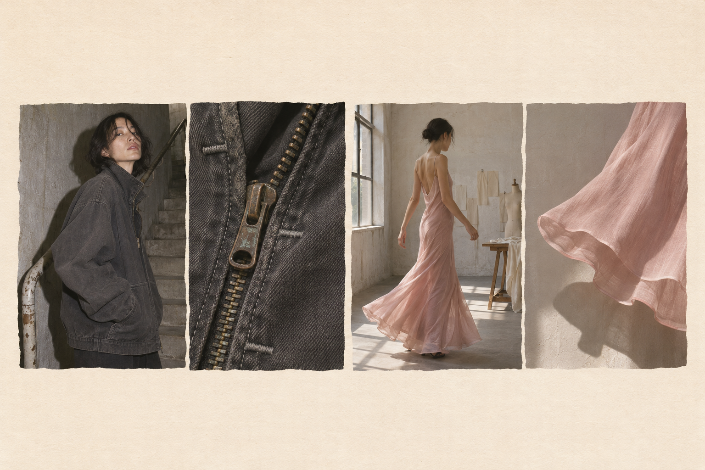

# Kuri Fashion · La prenda en dos planos

**Propuesta de fase 1 para validación artística.** Cada tienda se presenta mediante un díptico: una silueta permite reconocer cómo viste y un detalle explica cómo está hecha la prenda. Ambas fotografías son puertas al mismo escaparate. La portada se lee de lejos por sus siluetas y de cerca por sus tejidos.

Lámina conceptual generada con IA. Los comercios y prendas son ficticios. Para producción habrá que fotografiar o licenciar las prendas reales y rodar los gestos descritos.

## 1. Recorrido comprobado

Auditoría con Playwright y Edge Chromium, escritorio de 1440 × 900 y perfil táctil iPhone 13 emulado en Chromium. En una sesión nueva apareció una introducción audiovisual que empezó al pulsar. Para repetir las pruebas adelanté ese vídeo a su tramo final y dejé que terminara. Las capturas de esta sección documentan la referencia.

| Acción | Resultado observado |
|---|---|
| Abrir la galería | Diez franjas de unos 108 × 487 px, separadas por unos 20 px. Sus bordes superiores caen en tres niveles, aproximadamente 111, 141 y 176 px. La irregularidad procede del desplazamiento vertical. El fondo cálido, los fotogramas pálidos y el espacio alrededor de la firma permiten leer las diez imágenes como una sola composición. [Escritorio](003-fase-1/01-escritorio.jpg) |
| Posar el cursor sobre la tercera franja | La abertura visible pasó de unos 108 a 216 px. Las vecinas cedieron espacio hacia ambos lados. La escena recuperó el color y el pie central cambió de «Featured Work» a «Aladdin» y «Speechless». [Hover](003-fase-1/02-hover.jpg) |
| Retirar el cursor | Las primeras cuatro posiciones horizontales volvieron a 90, 218, 346 y 474 px. Los tiempos de los vídeos avanzaban ya en reposo. En la tercera franja, la propiedad muted pasó de verdadera a falsa al entrar y volvió a verdadera al salir. El reproductor siguió avanzando. Se verificó el estado del elemento, no el sonido por altavoces. |
| Pulsar la tercera franja | Las columnas se separaron y apareció un reproductor que llenaba visualmente la ventana, con material sobre la obra. A los cinco segundos el vídeo estaba reproduciéndose y document.fullscreenElement estaba vacío. La dirección incorporó el fragmento #extra-material-2. Escape mantuvo la vista abierta; el control de cierre devolvió la galería a sus posiciones iniciales. [Selección](003-fase-1/04-seleccion.jpg) |
| Usar rueda y menú | Una rueda vertical de 620 px dejó scrollY en cero y mantuvo la composición. El control superior derecho desplegó la navegación en un panel de 272 px de alto. [Menú](003-fase-1/03-menu.jpg) |
| Deslizar y tocar en móvil | La primera obra aparecía centrada, ancha y en color, con parte de la siguiente a la vista. Un arrastre hacia la izquierda llevó la cuarta franja al centro. Las cuatro previsualizaciones medidas seguían pausadas. Tocar la central inició la transición a la vista oscura. La captura del toque registra ese instante, no la reproducción posterior en móvil. [Inicio](003-fase-1/05-movil.jpg) · [Deslizamiento](003-fase-1/06-deslizar.jpg) · [Toque](003-fase-1/07-toque.jpg) |

**Lectura artística.** La relación entre vecinas hace legible el cambio de atención. Conservo esa relación, el escalonamiento y el paso de imagen tenue a imagen presente. En Kuri el color también comunica material: el índigo, el óxido y el tono del tejido deben seguir siendo reconocibles en reposo.

## 2. Portada y composición

Marfil mate #F5F2EB, tinta #242320 y un filete gris piedra #C8C2B8. Instrument Serif en nombres de tienda; Instrument Sans en navegación, precios, tallas y acciones. El nombre se imprime debajo de cada pareja, sobre marfil, siempre legible. La fotografía lleva el peso visual. La misma luz o el mismo gesto enlazan los dos planos de cada tienda.

**Escritorio, esquema de lectura a 1440 px**

~~~text
Kuri Fashion                       Tiendas    Categorías    Productos     Bolsa (0)

       SILUETA               detalle          SILUETA               detalle
       │     │ detalle       │    │           │     │ detalle       │    │
       │     │ │    │ SILUETA│    │           │     │ │    │ SILUETA│    │
       │     │ │    │ │     ││    │           │     │ │    │ │     ││    │

       Umbral         Casa Bies               Relevo         Plano
       Underground    Vestidos                Vintage        Contemporánea
~~~

Cuatro dípticos en una banda centrada de unos 1160 px. Calle interior de 8 px y separación entre tiendas de 32 px. Probar alturas de 350–450 px y desfases de 24–48 px, dejando aire entre cabecera y fotos. Umbral abre con una figura pesada; Bies responde con la caída clara del vestido. Relevo combina una chaqueta usada y el desgaste de su puño. Plano encuadra un abrigo unisex junto a una fachada y acerca la costura recta del hombro.

**Móvil, esquema a 390 px**

~~~text
Kuri Fashion                     Bolsa (0)
Tiendas       Categorías         Productos

    ┌────────────┐                   ┌────
    │  silueta   │ ┌───────┐         │
    │            │ │detalle│         │ sig.
    │            │ │       │         │
    └────────────┘ └───────┘         └────
    Umbral · Underground
    Entrar en Umbral →                 ›
~~~

Un díptico ocupa aproximadamente el 76 % de la pantalla; asoma el siguiente. Deslizamiento horizontal nativo con ajuste por tienda, botones anterior/siguiente y scroll vertical libre. Tap en cualquiera de las dos imágenes o en su nombre abre la tienda al primer toque. Al arrastrar se suprime la activación accidental. En teclado cada díptico constituye un solo enlace con foco visible.

## 3. Dos escaparates

| | Umbral · underground | Casa Bies · vestidos |
|---|---|---|
| Primera vista | Retrato a flash cortado a la altura de la rodilla, desplazado a la izquierda. A su derecha, cremallera oxidada a escala casi abstracta. El primer producto entra al pie del retrato. | Figura entera en luz lateral de ventana. El hueco delante de la modelo deja leer la dirección del giro. Una segunda imagen baja y ancha recoge el dobladillo. |
| Movimiento de portada | Cámara fija; una mano cierra la cremallera y se detiene. | Medio giro y dos segundos de reposo para ver cómo vuelve a caer el tejido. |
| Catálogo | Retícula compacta y asimétrica para la selección editorial; lista regular para comprar. Grafito y metal. «Chaqueta de lona lavada» da paso a corte, gramaje, talla y precio. | Dípticos espaciados de frente y espalda. Yeso y rosa empolvado. «Vestido al bies» da paso a largo, tejido, talla y precio. |

La cabecera Kuri, el retorno a Tiendas, la ficha de producto y la bolsa ocupan las mismas posiciones. El color de catálogo será fiel a la prenda. Un vestido vintage de Relevo podrá aparecer junto a Casa Bies en la categoría Vestidos; cada resultado conservará el nombre de su tienda.

## 4. Plan posterior a la validación

1. **Primer hito.** Cabecera común, galería de dípticos, enlace de tienda, previsualización de vídeo, escaparate y listado breve. Implementar Umbral y Casa Bies. Ruta directa a cada tienda, título enfocado al llegar y retorno a la misma posición y enlace al volver.
2. **Movimiento.** En puntero preciso, ampliar la franja unos 16 px en 220 ms. Reproducir solo el clip activo, silenciado y en línea. Al salir, pausar y recuperar el póster y la geometría inicial. Al entrar en tienda, mantener fija la cabecera y fundir el mismo encuadre en la fotografía de apertura durante unos 280 ms. Con movimiento reducido, mostrar póster y cambiar de vista de inmediato. Un fallo de vídeo conserva imagen, nombre y enlace.
3. **Segundo hito.** Incorporar Relevo y Plano, índice de categorías transversal, búsqueda o listado de productos, ficha compartida y bolsa de demostración. Cada producto referencia una tienda y sus categorías. El estado de la bolsa acompaña el recorrido entre comercios.
4. **Pruebas de aceptación.** Medir cajas antes y después de diez entradas/salidas rápidas; tolerancia de 1 px y máximo un vídeo activo. Probar clic, Enter, Atrás, enlace directo y foco. A 320 y 390 px verificar que un swipe nunca abre tienda y que un toque la abre. Probar Safari/iOS y Android físicos, movimiento reducido, red lenta y vídeo ausente. Desde Vestidos abrir productos de dos tiendas y comprobar una sola bolsa. Revisar con capturas el primer hito antes de ampliar el catálogo.

**Pendiente de validación artística.** El díptico debe leerse como una sola tienda, incluso si se tapa el nombre. En la revisión, comprobar que se distingue la caída del vestido y el peso de la chaqueta en el recorte estrecho, y que en móvil se descubre la siguiente tienda sin instrucciones. Los tiempos, tamaños y tratamientos de Kuri son propuestas. Las pruebas descritas para Kuri corresponden a fase 2.

[Referencia interactiva](https://www.alanmenken.com/) · [Documento de partida](003-DIRECCION-ARTISTICA.md)

